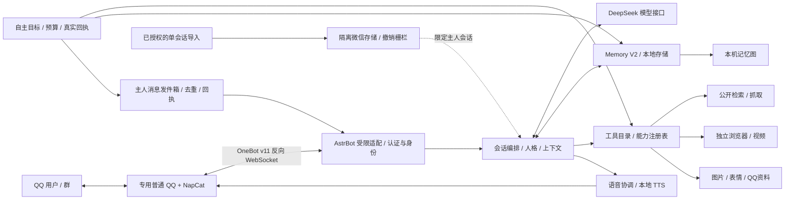

# 架构和代码地图

这份地图依据 2026-11-08 的项目代码与实施记录整理。历史文档可能保留当时的状态或路径，冲突时应先核验源码、配置和本机运行证据；仓库中的账号和群号均为示例值。

## 接入和会话

`run.py` 初始化受限 AstrBot 环境并关闭其 WebUI、内建命令及插件自动装载；`src/astrbot_runtime.py` 实现 OneBot / 模型适配。`src/contact_access.py`、`src/group_chat.py`、`src/group_dialogue.py` 等处理登录与账号校验、好友/群准入、发送目标及群上下文。接收或引用的消息不能单凭模型文本扩大权限。失败或未知的外部投递需保留实际状态，不能宣称已送达。

`src/conversation.py`、`conversation_state.py`、`chat_style.py`、`reply_context.py` 协调提示词、当前会话和消息上下文；`prompts/DAFEIYU_CHAT_STYLE.md` 是人物表达层，不授予工具或身份权限。`message_surface.py` 避免将内部标记混入用户可见正文。

## 记忆和能力

`src/memory_v2/` 包含录入、抽取、检索、版本/来源、衰减、删除、保留期、迁移及图接口；`src/storage.py` 管理本地持久状态。`memory_ui/` 提供记忆图界面。记忆按真实会话与主体隔离；删除、撤销和恢复应考虑版本及派生数据，不能简单覆盖旧数据库。

`config/capabilities.json` 与 `src/capabilities.py` 维护长期能力注册，`src/tool_catalog.py` 汇总模型可用工具。能力档案独立于可遗忘的个人记忆；具体可用性仍由运行配置和权限决定。

## 工具、多媒体和自主探索

`src/web_tools.py` 提供受限公开检索；`src/browser/` 通过 broker、policy、proxy 和 worker 管理隔离浏览器，网页内容本身不授予额外权限。`vision.py`、`stickers.py`、`qq_expressions.py`、`qq_favorites.py` 及相关群媒体模块处理实际图片、表情和回执。`src/voice/` 和 `tts_service/` 负责语音选择、合成及投递；外部引擎、权重和参考音频不在此仓库。

`src/autonomy.py`、`autonomy_tools.py` 和 `autonomy_social.py` 分别管理目标/任务、可用工具和主人分享；本地记录区分真实工具观察、失败、休息、观点与投递回执。历史部署曾使用有限的后台探索次数；归档模板默认关闭自动启动与分享，实际配置须重新核验。

## 微信单会话

`src/wechat_*.py` 和 `tools/wechat_readonly_probe/` 包含限定会话的绑定、读取、解码、导入、独立私有存储和撤销相关实现。只归档实现和合成测试，不归档任何聊天数据库、密钥、联系人或媒体。这里保留了原机专用身份限制的**示例替换值**，不能仅改配置便保证可迁移；详细见恢复说明。

## 运行数据边界

正常运行时，项目将本地配置、记忆、消息队列、运行日志和媒体放在隔离的配置/运行目录中。仓库没有原数据库、凭据或登录态，故不能从它恢复既有记忆、历史聊天、表情收藏或实际语音。独立音色与第三方模型的使用权需要另行核实。

## 核验状态

原项目记录过 2026-11-04 的完整离线回归和 2026-11-08 的探索记忆专项回归；这些是历史记录，并非此导出环境或未来部署的实时证明。本次独立验证以归档交付说明为准；没有发送真人测试消息，也没有为归档调用付费模型。
